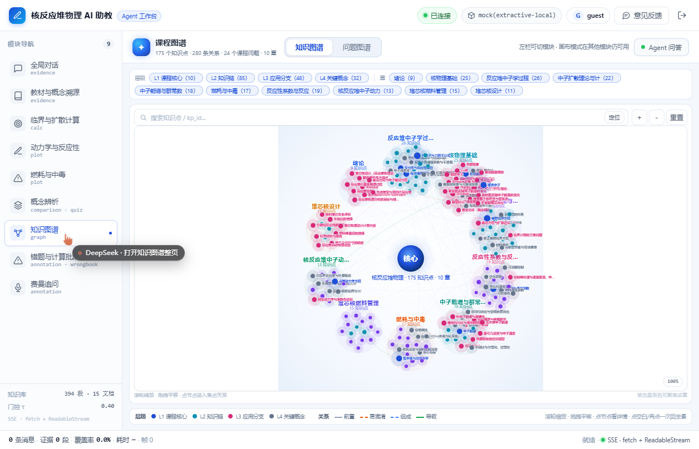
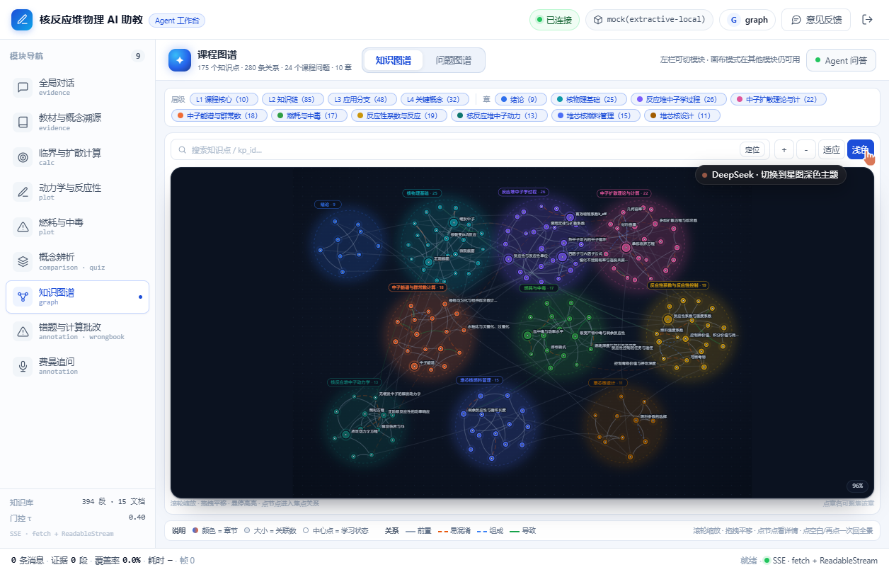
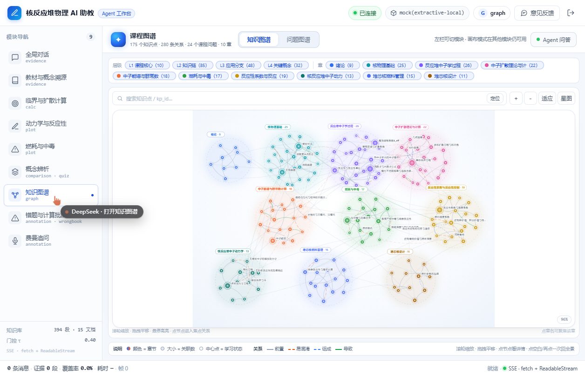

# 12 · 知识图谱视觉改版（从"星系毛球"到"章节星图"）

> 触发：用户反馈"知识图谱太丑了，有没有 GitHub 上找找别人好看的"。
> 本文件记录参考的 GitHub 项目、改版方案、前后对比与可调参数。

---

## 1. 参考的 GitHub 开源项目

| 项目 | 它好在哪里 | 我们借了什么 |
|---|---|---|
| [vasturiano/react-force-graph](https://github.com/vasturiano/react-force-graph) | 力导向图的事实标准实现：Canvas 渲染、悬停高亮一跳邻居、曲线边、粒子/箭头、缩放拖拽手感好 | 力导向 + 悬停高亮 + 弱化非活动边 |
| [DawsonBodenhamer/beautiful-graph](https://github.com/DawsonBodenhamer/beautiful-graph) | "电影感" Obsidian 图谱：深色底、节点微光、聚簇、克制的标签 |
| [cyrill0/fast-graph-view](https://github.com/cyrill0/fast-graph-view) | WebGL 版 Obsidian 图谱替换：Barnes-Hut + 按目录聚合，大图仍然清爽 | 按章聚合、聚合晕圈 |
| [antvis/Graphin](https://github.com/antvis/Graphin) | 蚂蚁 Graphin：浅色主题、焦点高亮、悬浮面板，中文知识图谱项目常用 | 浅色主题的层次与图例组织 |
| [jacomyal/sigma.js](https://github.com/jacomyal/sigma.js) | WebGL 大规模网络可视化，视觉上"网点 + 极淡边" | 低透明度关系线，突出节点 |
| 参考作品（[materials-lab-agent](https://materials-lab-agent.onrender.com/)） | 材料智能体的课程图谱：星系式布局 | 保留了"分章成簇"的信息结构 |

> 结论：没有直接换库（React 19 兼容 + 包体积 + 构建风险），而是**按这些项目共同的设计语言手写零依赖布局与渲染**：
> 分簇、弱化背景边、按重要度出标签、悬停聚焦、深色发光主题。

---

## 2. 改版前的问题

旧版是"中心核心 + 10 个星系环"的硬排版：

- 每个章是圆环里的等距螺旋点，**节点分布与关系强度无关**；
- 章名与节点标签叠在一起，放大后才勉强可读（"标签汤"）；
- 中心有一个装饰性"核心"大圆，与任何数据无关，占了大量空白；
- 白色正方形画布嵌在卡片里，四周大片留白。

---

## 3. 改版方案（零依赖，`modules/graph/layout.ts` + `Overview.tsx`）

### 3.1 布局

1. **10 个章节按课程顺序排成 4-3-3 网格锚点**（第 1~4 章一行、5~7 章一行、8~10 章一行，奇数行错位半格）；
2. **每个簇内部单独做力导**：锚点弹簧 + 簇内排斥 + 碰撞 + 目标半径约束（半径随节点数 `54+10.5√n`，并受网格单元上限约束）；
3. **跨章关系只画线、不参与受力**——这是旧版"拉成一团"的根因；
4. 使用固定随机种子（`lcg(20261109)`），同一份数据每次布局完全一致，刷新不跳动；
5. 全图等比归一化到 1280×920 的 viewBox，"适应"按钮按内容包围盒 fit。

### 3.2 视觉

| 元素 | 旧版 | 新版 |
|---|---|---|
| 节点颜色 | tier（5 类） | **章节（10 色）**，章筛选 chip 上同步显示色点 |
| 节点大小 | 固定 + 少量度数加成 | 度数 + tier 共同决定（core 最大） |
| 章节 | 虚线圆 + 上下两行小字 | **PCA 主轴拟合椭圆**（半透明晕 + 虚线轮廓）+ 左上角章节 pill（`章名 · N`） |
| 标签 | core / dense 全出，互相压字 | 只出 core + 度数 ≥5 + 悬停/选中；**贪心碰撞检测**，重叠的标签直接不画 |
| 关系线 | 0.2 透明度全量 | 同簇 0.34 / 跨簇 0.13；`vector-effect: non-scaling-stroke`，任何缩放下都清晰；悬停时一跳邻居 0.9 高亮、其余降到 0.03 |
| 主题 | 只有浅色 | **浅色 / 星图（深色）双主题**，默认星图；深色下章节晕与节点发光 |
| 中心 | 装饰性"核心"大圆 | 去掉（信息密度留给节点），统计数字交给页头与图例 |

### 3.3 交互（保持旧版能力）

- 滚轮缩放（以光标为中心）/ 拖拽平移 / 双击重置；
- 搜索定位（知识点名或 kp_id）并居中放大；
- 悬停节点：高亮它的一跳邻居，弹出信息卡（含 kp_id / 层级 / 学习状态 / 章节）；
- 点节点：整页模式下右侧出详情面板（旧行为不变）；
- 点章名 pill：聚焦该章；
- 顶部筛选：按层级 L1~L4、按章（章 chip 带色点），过滤后布局不变、只隐藏；
- 主题切换按钮：`星图 ⇄ 浅色`。

---

## 4. 前后对比

| 改版前 | 改版后（深色，默认） |
|---|---|
|  |  |
| 白色星系环、标签重叠、中心大圆 | 章节分簇、发光节点、标签避让、跨章弱连线 |

浅色主题：

---

## 5. 验证

- `npm run typecheck` / `npm run build` 通过（77 modules，JS 约 427 KB / gzip 135 KB，CSS 77.5 KB）；
- 本地起 uvicorn + 真实 175 节点 / 280 边数据渲染截图（见上），缩放/悬停/筛选/搜索/主题切换均手工验证；
- 已 push 到 `reactor-physics` 分支，Render 自动重新部署（`https://reactor-physics-agent.onrender.com/`）。

---

## 6. 可调参数（都在代码里，无需重建数据）

| 想调什么 | 改哪里 |
|---|---|
| 章节配色 | `apps/web/src/modules/graph/layout.ts` → `CHAPTER_COLORS` |
| 簇大小 / 网格留白 | `layout.ts` → `radiusOf` 的 `54 + 10.5*sqrt(n)`、`MARGIN_X/Y`、`cap * 0.42` |
| 节点大小 | `layout.ts` → `r = (core?…) + 最小(5, deg*0.32)` |
| 标签出现门槛 | `Overview.tsx` → `labelBoxes` 里 `p.degree >= 5`、`showAllLabels`（缩放 ≥1.5 全出） |
| 关系线透明度 | `Overview.tsx` → `strokeOpacity={... same ? 0.34 : 0.13}` |
| 默认主题 | `Overview.tsx` → `useState<'light' \| 'dark'>('dark')` |
