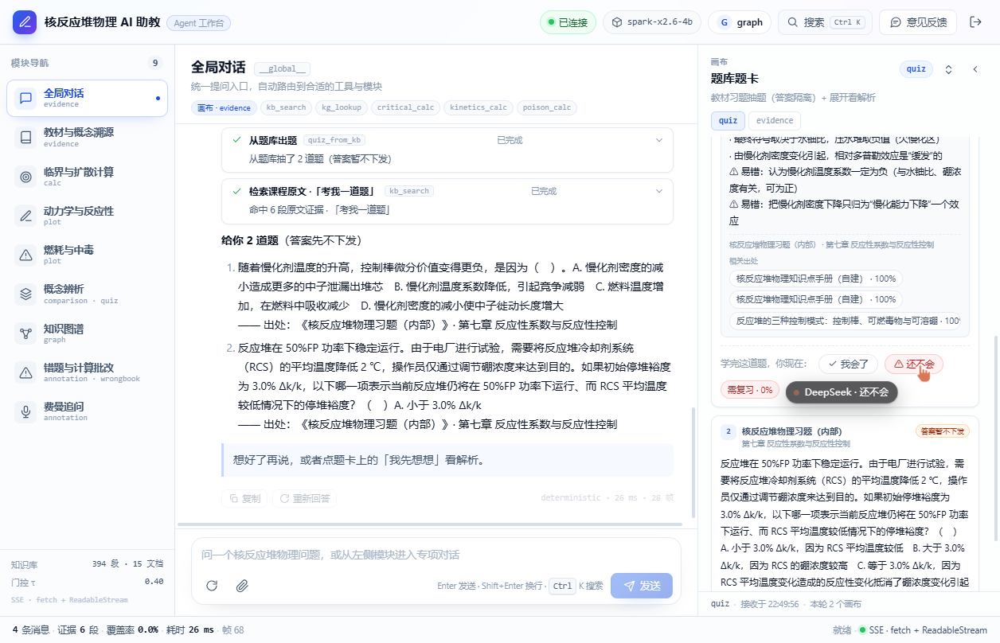

# 15 · P0 落地记录：真实星火模型 / 会话持久化 / 掌握度回写

> 对应 [14-同类开源项目对比调研.md](14-同类开源项目对比调研.md) 里的 P0 建议。
> 本轮先落地三件：**把星火接回来**、**刷新不丢会话**、**做题回写掌握度并点亮图谱**。

---

## 1. 星火大模型（讯飞星辰 MaaS）

之前机械制图工程已经用讯飞星辰 MaaS 的免费模型 `spark-x2.6-4b` 跑通过，这次把同一套配置搬到本工程（环境变量名换成 `RP_` 前缀）：

| 配置项 | 值 |
|---|---|
| `RP_LLM_PROVIDER` | `openai-compatible` |
| `RP_LLM_BASE_URL` | `https://maas-api.cn-huabei-1.xf-yun.com/v2` |
| `RP_LLM_MODEL` | `spark-x2.6-4b`（¥0/百万 tokens） |
| `RP_LLM_API_KEY` | 本地 `apps/api/.env`（不进仓库）+ Render 控制台环境变量 |
| `RP_LLM_EXTRA_BODY` | `{"thinking":{"type":"disabled"}}` |

- **本地**：`/api/health` 返回 `provider=openai-compatible, model=spark-x2.6-4b, llm_ready=true`；概念题 ~10–13s，计算题仍走确定性引擎（毫秒级）。
- **线上**：Render 环境变量已配置，`https://reactor-physics-agent.onrender.com/api/health` 同样返回星火就绪。
- 仓库里同步更新了 `render.yaml` 的默认值和 `.env.example`（Key 永远 `sync: false` / 留空）。

### 顺手修掉的一个真实风险：硬门控

接上真实模型后实测发现：当检索覆盖率低于 τ（例如问"量子引力"），即使提示词写了"知识库未收录"，星火仍会绕过去、用课程外知识编答案（还会伪造"依据证据5"）。

修法：**在 orchestrator 里硬门控**——`gated=true` 或没有命中时，直接返回本地拒答模板（provider=`gate`），根本不把边缘证据交给模型。实测：

- `量子引力是什么？` → `**知识库未收录**`，不再编造
- `什么是缓发中子？为什么重要？` → 正常由星火作答

## 2. 会话持久化（刷新不丢）

- 位置：`apps/web/src/lib/store.ts`
- 按账号把 `messages / artifacts / draft / stats` 写进 `localStorage`（键 `rp.sessions.v1:<account>`），400ms 防抖；
- 只存最近 40 条消息、最近 6 个画布，单画布数据 >60KB 跳过，避免撑爆配额；
- 启动/登录时自动恢复，并提示「已恢复上次的对话记录」；
- 登出前落盘，重新登录同一账号还能接着用。

实测：提问 → 刷新页面 → 消息、画布 tab、草稿都还在。

## 3. 学习者模型 v1（自评 → 掌握度 → 图谱）

### 后端

- 新表 `mastery(account, kp_id, score, attempts, correct, state, last_signal, last_at)`（SQLite，独立于 users.records）；
- `POST /api/mastery/report`：`signal=got/again`，按 EWMA 更新分数：
  - `got`：`score += 0.35`（≥0.75 记「已掌握」）
  - `again`：`score *= 0.45`（记「需复习」）
- `GET /api/mastery`：返回掌握度 + 各状态计数；
- `/api/graph` 增加 `X-Account` 叠加：节点的 `state` 用该账号掌握度覆盖；
- `again` 且带题面/解析时，自动写入 `wrongbook`。

### 前端

- 题卡展开解析后出现「我会了 / 还不会」两个按钮（`modules/quiz/Canvas.tsx`）；
- 点击后调 `/api/mastery/report`，toast 反馈，并让图谱缓存失效（下次进图谱按新 state 着色）；
- 「还不会」自动记入错题本（题面 + 解析 + chunk_id + kp_ids）。

实测链路：出题 → 展开解析 → 点「还不会」→ 提示"已记入错题本 · 图谱状态更新为「需复习」"；`/api/graph` 对应节点 `state=需复习`；`/api/wrongbook` 多一条记录。

### 一个诚实的降级

题库来自扫描件，112 道习题的 `kp_ids` 全是空，没法逐知识点回写。当前实现退化为**章级掌握度**（`chapter:<章名>`），图谱里该章所有节点一起变色；等题库补上 kp 标注后再切回逐知识点。

## 4. 其他小修

- "考我一道题"原来不会触发 `quiz_from_kb`（`QUIZ_PAT` 没覆盖"考我"），已补；
- 前端顶栏现在显示 `spark-x2.6-4b`（来自 `/api/health`），不再显示 mock；
- `render.yaml` / `.env.example` 同步星火配置。

## 5. 验证

- 本地：`/api/health` 星火就绪；概念题 10–13s；"量子引力"被硬门控拒答；"考我一道题"出题卡；自评后 mastery/graph/wrongbook 三处一致；刷新后会话恢复。
- 线上：Render 环境变量生效后 `/api/health` 返回 `provider=openai-compatible, model=spark-x2.6-4b, llm_ready=true`。
- 构建：`npm run build` 通过（81 modules，JS ≈ 443 KB / gzip 140 KB）。

## 6. 已知限制 / 下一步

| 限制 | 影响 | 下一步 |
|---|---|---|
| Render 免费档无持久盘，SQLite 会随重启/重部署重置 | 掌握度/错题本/会话表在线上不跨天保存 | 接 Render Disk 或 Supabase/Postgres |
| 会话只在浏览器 localStorage | 换设备/换浏览器不同步 | 接后端 conversations/messages 做历史侧栏（已落库，只差接口+UI） |
| 掌握度是"自评"而非自动判分 | 学生可能高估自己 | 下一步用星火做答案比对/填空题判分 |
| 习题无 kp_ids | 只能章级回写 | 人工补标 112 题的 kp_ids |
| GraphRAG-lite 尚未做 | 多跳/前置类问题召回仍靠 chunk | 用现有 175 节点/280 边做 1–2 跳扩展检索，在 54+26 probes 上 A/B |

---

相关文件：

- 后端：`apps/api/app/{main.py,db.py,orchestrator.py,llm.py}`、`apps/api/.env`（本地，不进仓库）
- 前端：`apps/web/src/lib/{store.ts,api.ts,types.ts}`、`modules/quiz/Canvas.tsx`、`features/graph/Page.tsx`、`app.css`
- 部署：`render.yaml`、`.env.example`
