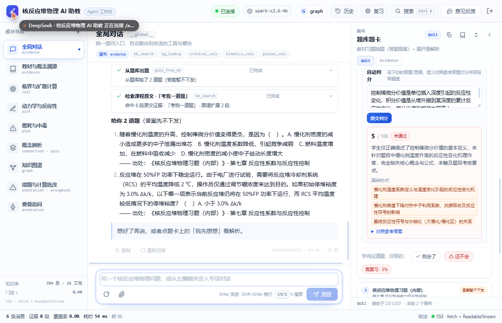

# 16 · 第二轮增强：缓存 / 图谱检索 / 判分 / 历史 / 复习 / 导出

> 用户："都做做吧"。这一轮把 [14](14-同类开源项目对比调研.md) 里列出的 P0/P1 大部分做成了可用版本，
> 并补了教师端与导出。仍然不引新框架，全部在现有 FastAPI + React 上增量实现。

---

## 1. 速度与稳定性（LLM 层）

- **语义缓存**：`llm.py` 内存 LRU（128 条），键 = 问题 + 证据 + persona 的 SHA1。
  相同问题第二次直接返回（provider=`cache`），省 10–18s。
- **超时/重试/降级**：`RP_LLM_TIMEOUT`（默认 60s）；失败重试 1 次，仍失败自动降级到本地证据抽取（provider=`mock-fallback`），对话不中断。
- **硬门控**（上一轮已加）：gated/无命中时直接拒答，不交给模型自由发挥。

## 2. GraphRAG-lite：让图谱参与检索

`tools/kb_search.py` 新增 `_graph_expand()`：

1. 命中块 → `kp_ids` → 图谱节点；
2. 沿 `edges`（前置/对比/组成/因果）取 1 跳邻居；
3. 从邻居知识点的块中取最多 2 段与问题词元重叠最高的，标 `related: true / via: [...]`；
4. **不改原检索的 coverage 与门控**，只补上下文；工具摘要会显示"图谱扩展 N 段"。

作用：概念题/多跳题能带上"前置知识"的原文，而拒答边界保持原样。

## 3. 习题知识点标注（解决章级降级）

- 新脚本 `scripts/annotate_exercise_kp.py`：同章内用题干 vs 知识点（term+aliases+definition+points）的 BM25 式词元重叠打分，取 top1（必要时 top2），离线、确定性、不调模型；
- 结果：**112/112 题全部有 kp_ids**（55 题给了 2 个），已写回 `kb/exercises/exercises.jsonl`（备份在 `working/_exercises_before_kp_*.jsonl`）；
- 重建索引（`pipeline/build_kb.py`，旧索引备份在 `working/_index_before_exercise_kp_*`）；
- 题卡自评/判分现在写到具体知识点，图谱节点能精确变色。

## 4. 自动判分（星火阅卷）

- 后端 `POST /api/quiz/grade`：学生答案 + 检索到的参考答案 → 星火按评分点输出 JSON（score/verdict/feedback/missing）→ 回写掌握度（score 作为 quality 做 EWMA）→ 不及格自动写错题本；
- 前端题卡：解析展开后出现「自动判分」输入框 + 提交按钮，显示分数、评语、漏掉的点、对照参考答案；
- 兜底：模型不可用时退回关键词覆盖率判分。
- 实测：一道"反应性控制方式"题，学生只答了控制棒价值 → 5 分 / 未通过 / 三条 missing，正确写入掌握度与错题本。

## 5. 历史会话（后端已有数据，补 UI）

- 后端：`GET /api/history`（当前账号的会话列表，含模块/标题/条数/更新时间）、`GET /api/history/{id}`（消息，带账号归属校验）；
- 前端：顶栏「历史」/ 命令面板「打开历史会话」→ 右侧抽屉；点一条恢复消息到对应模块（画布 artifact 未入历史，只恢复消息）。
- 注意：后端本来每轮就写 `conversations/messages`，这轮只是把已有数据接出来。

## 6. 今日复习（FSRS-lite）

- 后端 `GET /api/review`：按掌握度 + 最近练习时间算到期（需复习 1 天、<75% 3 天、≥75% 7 天）；
- 前端：顶栏「复习」→ 抽屉列出到期知识点（状态/掌握度/逾期天数），点「复习这个」自动切到知识图谱模块并发起针对性追问。

## 7. 导出与打印

- 画布右上新增「导出 Markdown」（把当前画布文本落成 `.md`）与「打印 / 另存为 PDF」（展开画布后 `window.print`）；
- 打印样式隐藏顶栏/左栏/对话区，只留画布。

## 8. 教师端：掌握度看板

- `admin_overview` 增加 `mastery_states`（各状态人数）与 `mastery_top`（最需要关注的知识点，按练习次数排序）；
- `/admin` 新增「学习者模型」卡片：状态分布条 + 待关注知识点表。

## 9. 回归与验证

- 锚点测试：68/68 通过；smoke：27/27（8 类画布全可达）。
- 探针：标定集 54/54，holdout 25/26（H10 覆盖率 0.396 卡在 τ=0.40 边界，未变差）。
- 本地实测：历史抽屉、复习抽屉、判分（5 分 case）、图谱扩展（摘要"图谱扩展 2 段"）、导出按钮均正常。
- 线上：部署后 `/api/health` 仍为 `spark-x2.6-4b / openai-compatible / ready=true`。

## 10. 仍然没做的（下一轮候选）

| 项 | 原因 |
|---|---|
| 图片拍题 / 公式多模态 | 需要视觉模型与上传链路，改动面大 |
| 语音输入/朗读 | 未接入 Web Speech / TTS |
| PWA / 移动端底部导航 | 目前只做了窄屏响应式 |
| 全局深色模式 | 工作台仍是浅色（图谱已有深色） |
| 真正持久化 | Render 免费档无磁盘；掌握度/错题本/历史会随重启重置 |
| 复习计划的通知/推送 | 目前是打开抽屉才计算 |
| 历史恢复画布 | 只恢复消息，artifact 未入历史表 |

---

相关文件：

- 后端：`apps/api/app/{llm.py,config.py,main.py,db.py}`、`tools/kb_search.py`、`static/admin.html`
- 前端：`shell/{HistoryDrawer,ReviewDrawer,TopBar,CommandPalette,CanvasPanel}.tsx`、`modules/quiz/Canvas.tsx`、`lib/{store,api}.ts`、`app.css`
- 数据/脚本：`kb/exercises/exercises.jsonl`、`scripts/annotate_exercise_kp.py`
