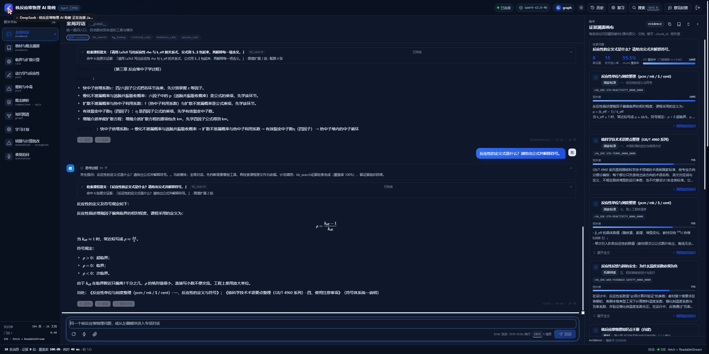
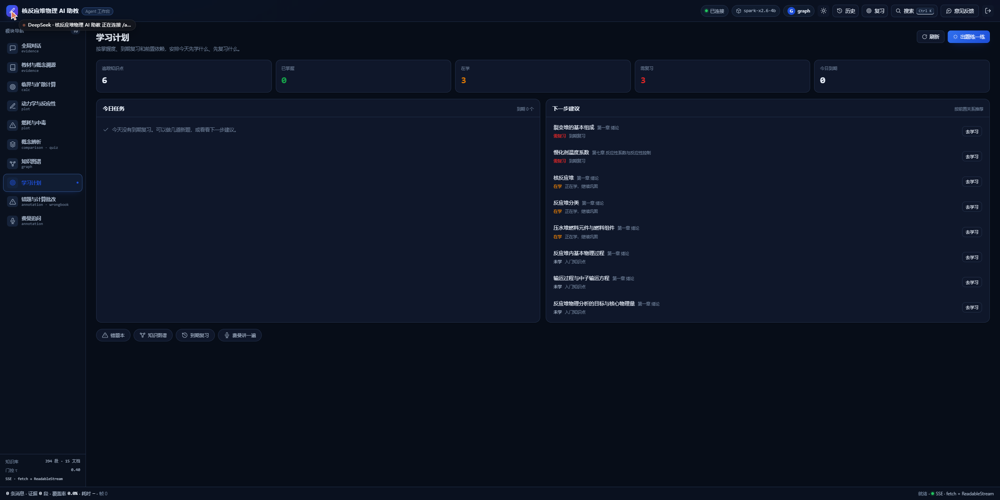

# 19 · 公式渲染（KaTeX）+ 学习计划模块

> 用户："先两个改一改吧"——先做 [上一轮建议](../教学agent/核反应堆物理agent/docs/18-继续尝试-OCR增强与数据备份.md) 里的前两件：
> ① 公式渲染 + 公式输入；② 学习计划模块。

---

## 1. KaTeX 公式渲染

- 新增依赖 `katex@0.16.21`（前端，离线打包，字体随 dist 一起发；不依赖 CDN）。
- `shell/Markdown.tsx` 注册 marked 扩展：
  - 行间：`$$...$$`、`\[...\]` → `displayMode`；
  - 行内：`\(...\)`、`$...$` → inline；
  - **`$...$` 有防误伤规则**：内容必须含 `\ ^ _ = < >` 或希腊字母才当公式，避免把反应性单位"0.2$"、价格等误渲染；
  - `throwOnError: false`，坏公式降级为 code，不炸整条回答。
- 后端 `SYSTEM_PROMPT` 加了一句：**公式一律用 LaTeX（行内 `$...$`、行间 `$$...$$`），不要用 Unicode 上下标拼公式**，这样星火输出能稳定走渲染。
- 实测：问"反应性的定义式是什么？"→ 星火返回
  `$$\rho = \frac{k_{\text{eff}}-1}{k_{\text{eff}}}$$`，前端渲染出标准分式（截图 `_p3_katex.png`）。

## 2. 学习计划模块（第 10 个模块）

- 后端 `MODULES` 新增 `study`（name=学习计划，icon=target，page-only）。
- 新增 `GET /api/plan`：
  - **due**：复用 FSRS-lite 到期逻辑（需复习 1 天 / <75% 3 天 / ≥75% 7 天）；
  - **counts**：已掌握 / 在学 / 需复习 统计；
  - **recommendations**：按图谱 `prereq` 前置关系筛选——未学但前置已掌握、在学、需复习的知识点，给出来源/原因，最多 8 个。
- 前端整页模块 `features/study/Page.tsx`：
  - 顶部统计卡（追踪知识点 / 已掌握 / 在学 / 需复习 / 今日到期）；
  - 今日任务（到期复习）→「去复习」自动切到概念辨析并发起出题；
  - 下一步建议（推荐知识点）→「去学习」自动切到教材溯源并发起讲解；
  - 快捷入口：错题本、知识图谱、到期复习抽屉、费曼讲一遍；
  - 空态：还没有记录时引导去出题/看图谱。
- 注册表放宽了一处：**允许 `artifactTypes=[]` 但有 `page` 的 feature**（page-only 模块），不再被当成"没有画布"跳过。
- 模块任务书由 `scripts/gen-module-docs.py` 重新生成：现在 **10 模块 / 9 feature / 11 工具**，`--check` 通过；smoke 期望值同步改为 10。

## 3. 顺手修的一个路由 bug

问"反应性 rho 与 k_eff 的**关系式**"时，`GRAPH_WORDS` 里的裸词"关系"把问题劫持到知识图谱分支，答非所问。
已改为 `关系图 / 知识关系 / 前置 / 依赖 / 学习路径…`，并保留 `feature=="graph"` 的强触发；公式/定义类问题回到 `kb_search` → 星火作答。

## 4. 验证

- 本地：
  - KaTeX：`.md .katex` 8 个、`.katex-display` 1 个，分式渲染正常；
  - 学习计划：`/api/plan` 返回 due/counts/recommendations，页面统计与列表正常；
  - 锚点 68/68、smoke 27/27（10 模块）、模块任务书 `--check` 通过；
  - 探针：标定 54/54、holdout 25/26（H10 边界未变）。
- 线上：部署后验证 `/api/modules` 含 `study`、`/api/plan` 正常、公式问题在页面上渲染（截图见下）。

## 5. 下一步（剩余的模块建议）

1. **作业/班级模块**（教师发卷 → 学生作答 → 自动判分 → 班级报告）；
2. **课程 CMS**（老师自己改知识点/题目/图谱，不用手改 JSONL）；
3. **学生画像/家长报告**（把 mastery + 错题 + 提问记录汇总成一页）；
4. **情感支持 / 学习陪伴**（EduChat 路线）；
5. **实时语音对话**（现在是语音输入 + TTS，不是连续对话）。

---

相关文件：

- 前端：`shell/Markdown.tsx`、`features/study/{Page,Canvas,index}.tsx`、`modules/registry.ts`、`app.css`、`package.json`
- 后端：`app/state.py`、`app/main.py`（/api/plan）、`app/orchestrator.py`（GRAPH_WORDS）、`app/llm.py`（LaTeX 提示词）
- 脚本/文档：`scripts/gen-module-docs.py`、`docs/模块任务书/study.md`、`apps/api/tests/smoke.py`
