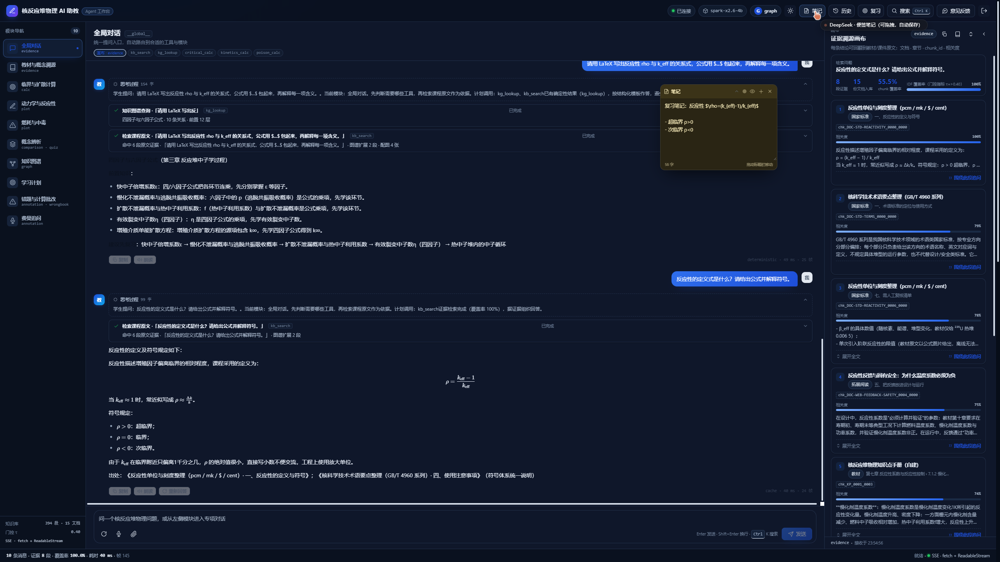

# 20 · 可拖拽便签（自定义笔记）

> 用户："给一个可拖拽的卡片放在哪里吧，可以自定义笔记那种"。
> 放在**工作台最上层（浮层）**：不占三栏布局，随手记，可拖到任意位置；按账号自动保存。

---

## 1. 入口

- 顶栏「笔记」按钮（便签图标）
- 命令面板 `Ctrl/⌘+K` →「打开便签笔记」

打开后默认在工作区右侧生成一张便签；右上角工具条可以再新建多张。

## 2. 交互

| 操作 | 说明 |
|---|---|
| **拖动** | 按住标题栏拖动（`pointerdown/pointermove` + window 监听，鼠标/触屏都可用）；位置限制在视口内，标题栏始终可见 |
| **编辑** | 正文 textarea，自动保存（400ms 防抖） |
| **预览** | 眼睛按钮切换 Markdown 预览；支持 KaTeX 公式（与聊天里的 `$...$` 同一套渲染） |
| **颜色** | 标题栏色点循环：黄 / 粉 / 蓝 / 绿 / 紫 |
| **折叠** | chevron 按钮收起正文，只留标题栏 |
| **多张** | 「+」新建，最多 12 张（超出不保存） |
| **关闭** | 「×」删除当前便签；最后一张关闭后浮层消失 |
| **持久化** | `localStorage['rp.notes.v1:<账号>']` 存内容/位置/颜色/折叠/预览状态；刷新、关页面、重新登录都在 |

## 3. 细节

- 浮层 `pointer-events:none`，只有便签本身 `pointer-events:auto`，不挡下面的对话/画布操作；
- z-index 78，低于命令面板（90）、Toast（100）；
- 深色模式有对应配色（深底浅字）；
- 宽度固定 300px，窄屏 `min(300px, calc(100vw - 24px))`；
- 公式预览复用 `shell/Markdown.tsx`，因此 `$\rho=(k_{eff}-1)/k_{eff}$` 会渲染成分式。

## 4. 验证

- 本地实测：
  - 拖拽：便签从 `x=2230` 拖到 `x=1690 / y=216`；
  - 刷新页面后重新打开「笔记」，位置与内容都还在；
  - 预览模式 `.katex` 正常渲染；
  - 多张、折叠、颜色、关闭均正常。
- 线上：部署后顶栏「笔记」按钮与浮层可用（截图见下）。

## 5. 已知限制 / 可扩展

- 只在**同一浏览器同一账号**持久化（localStorage）；跨设备要接后端 notes 表；
- 便签不进入学习数据备份（`/api/backup` 只含 mastery/wrongbook/records），后续可加；
- 目前是纯文本 + Markdown，没有富文本工具栏（加粗/列表按钮）；
- 没有"钉住/置顶/透明度"；位置超出视口会自动夹紧。

---

相关文件：`lib/notes.ts`、`shell/StickyNotes.tsx`、`shell/TopBar.tsx`、`shell/CommandPalette.tsx`、`App.tsx`、`app.css`
